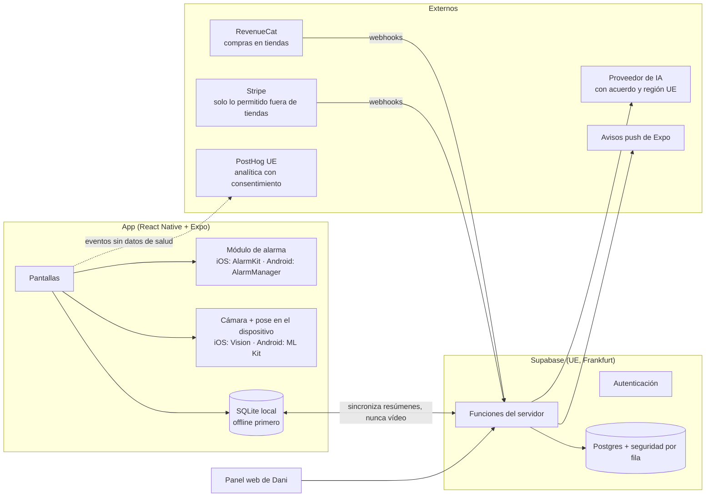
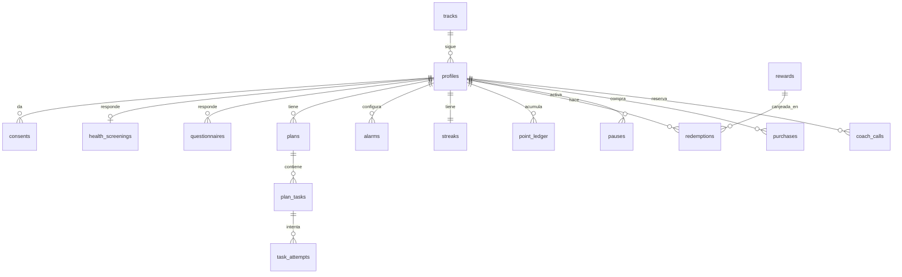
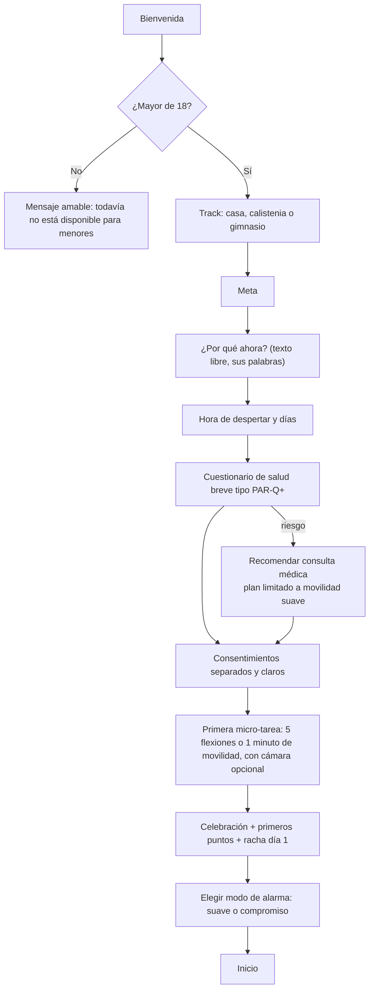
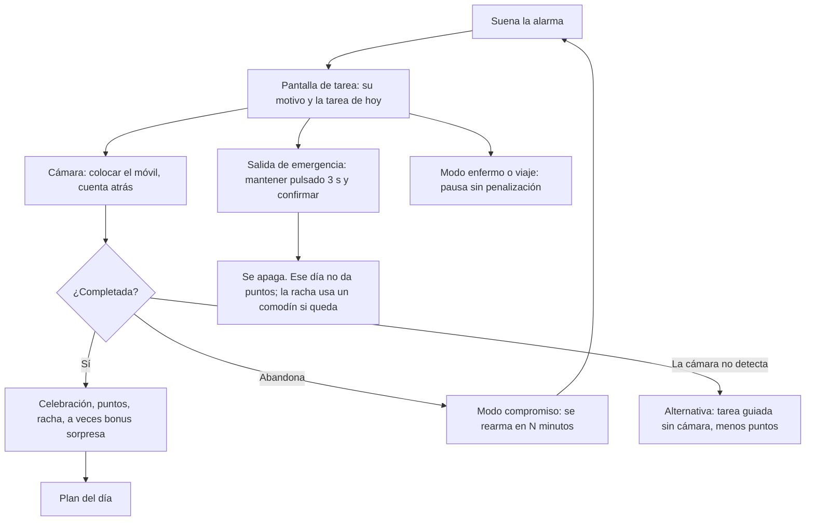
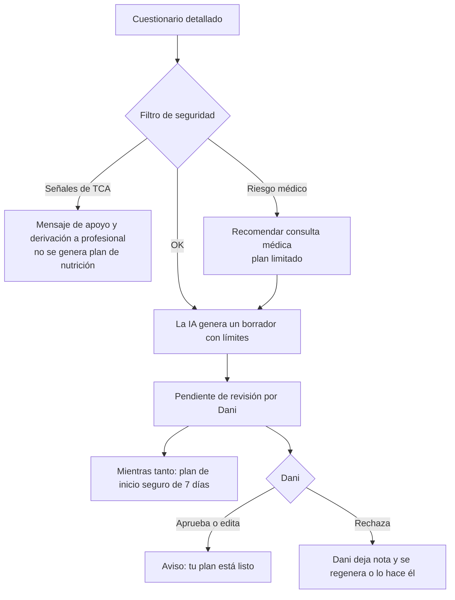

# Fase 1: arquitectura, datos, flujos y sistema de puntos

Estado: **borrador para revisar**. Nada de esto está programado todavía.
Hoja de cálculo de la economía de puntos: [`economia-puntos.xlsx`](economia-puntos.xlsx).

## 0. Decisiones tomadas (Fase 0)

| Tema | Decisión |
|---|---|
| Plataformas | iOS y Android |
| Stack | React Native + Expo (development builds) con módulos nativos donde haga falta |
| Repositorio | Este mismo (`home-reps`). La web `index.html` es el prototipo; la app nativa vivirá en `app/` |
| Idioma de la app | Inglés (mercado general). Documentación interna en español |
| Públicos | Varios "tracks": casa sin material, calistenia, gimnasio… La marca se decide más adelante |
| Planes de IA | Dani revisa cada plan antes de entregarlo (al menos al principio) |
| Pendiente de hablar con Dani | Quién programa (2), presupuesto (3), empresa y pagos (4), precios y llamadas (6), proceso de revisión de planes (7) |
| Más adelante | Apple Salud / Health Connect, nombre de marca |

Ajustes aplicados respecto a la idea original (explicados en la Fase 0):

1. **Alarma "que se rearma"** en lugar de "imposible de parar": los sistemas no permiten lo segundo.
2. **Cocinar no se verifica solo con cámara**: foto del plato + lista de ingredientes, con menos puntos, y separado de la alarma.
3. **Tarea de la alarma corta** (menos de 2 minutos). La rutina larga va aparte.
4. **Sin puntos por reseñas en las tiendas.** Sí por encuestas internas.
5. **Cobros según el tipo de servicio** (compras de la tienda para contenido digital; llamadas 1 a 1 pueden ir fuera). Se cierra en la Fase 5.
6. **Conteo de flexiones con margen de error** y alternativa si falla la detección.
7. **Cumplimiento desde el diseño**: EIPD, consentimientos separados, datos en la UE, aviso de IA, posicionamiento de bienestar (no médico).
8. **Solo mayores de 18** en el lanzamiento.

## 1. Arquitectura



### Piezas y por qué

- **App en React Native + Expo.** Un solo código para iOS y Android. Lo que Expo no cubre va en módulos nativos propios:
  - **Alarma.** En iOS 26 o superior, **AlarmKit**: suena aunque el móvil esté en silencio o en modo concentración. En Android, **AlarmManager** con alarma exacta, aviso a pantalla completa y un servicio en primer plano mientras suena. Los permisos `USE_EXACT_ALARM` y `USE_FULL_SCREEN_INTENT` están permitidos en Google Play para apps de alarma.
  - **Verificación por cámara.** VisionCamera con un procesador de fotogramas propio: Vision (`VNDetectHumanBodyPoseRequest`) en iOS y ML Kit Pose Detection en Android. **Ningún fotograma sale del móvil.** Al servidor solo llega el resumen: repeticiones, duración, nivel de confianza y el token de integridad del dispositivo.
  - **Offline primero.** Las tareas del día y su verificación funcionan sin conexión, porque la alarma de las 8:00 no puede depender de la red. Se sincroniza después.
- **Supabase en la UE.** Inicio de sesión, base de datos Postgres con permisos por fila y funciones del servidor. Los datos de salud se guardan en tablas separadas con permisos más estrictos y cifrado de columnas.
- **Funciones del servidor.** Llevan la lógica que no debe vivir en el móvil:
  - `generate-plan`: llama a la IA con datos mínimos, aplica límites de seguridad y deja el plan "pendiente de revisión".
  - `record-attempt`: valida un intento (integridad del dispositivo con App Attest y Play Integrity, topes diarios, patrones raros) y **es el único sitio que da puntos**.
  - `redeem`: canjes con topes.
  - Webhooks de RevenueCat y Stripe.
  - `data-export` y `data-delete` (RGPD).
- **Panel de Dani** (web React). Lo usa para revisar y aprobar planes, ver usuarios con su consentimiento, gestionar llamadas y ver pagos.
- **Analítica.** PostHog en la UE, solo con consentimiento y **sin datos de salud** en los eventos.

### Estructura del repositorio (propuesta)

```
home-reps/
  index.html            prototipo web (se mantiene)
  media/                vídeos del prototipo
  app/                  app Expo (fase 2+)
  admin/                panel de Dani (fase 4)
  packages/core/        lógica compartida en TypeScript: puntos, rachas, niveles (con tests)
  supabase/migrations/  esquema SQL
  supabase/functions/   funciones del servidor
  docs/                 esta documentación
```

## 2. Modelo de datos



| Tabla | Campos clave | Notas |
|---|---|---|
| `tracks` | id, name, equipment | Casa sin material, calistenia, gimnasio… Los ejercicios se etiquetan por track |
| `profiles` | id, birth_year, age_verified, locale, timezone, track_id, goal, why_now, wake_time | `why_now` es el motivo del usuario, con sus palabras |
| `consents` | user_id, kind, version, granted_at, revoked_at | Tipos: `health_data`, `ai_processing`, `analytics`, `marketing`, `video_upload`. Uno por fila: se pueden retirar por separado |
| `health_screenings` | user_id, answers (cifrado), risk_level, flags, created_at | Basado en PAR-Q+. `flags`: lesión, embarazo, medicación, riesgo de TCA… |
| `questionnaires` | user_id, kind, answers (cifrado), version | `onboarding`, `detailed_plan`, `checkin` |
| `plans` | id, user_id, kind, source, status, content, safety_limits, prompt_version, reviewed_by, reviewed_at, review_note | `kind`: entrenamiento, nutrición o combo. `source`: IA o coach. `status`: borrador → pendiente de revisión → aprobado o rechazado → activo → archivado |
| `plan_tasks` | id, plan_id, date, type, spec, points | `type`: `wake_task`, `workout`, `meal` |
| `task_attempts` | id, task_id, started_at, ended_at, method, result, reps, confidence, integrity_ok, client_id | `method`: `pose`, `photo`, `checklist`, `fallback`. `client_id` evita duplicados al sincronizar |
| `alarms` | user_id, time, weekdays, mode, rearm_minutes, max_minutes, active | `mode`: `gentle` (por defecto) o `commit` (activado por el usuario) |
| `pauses` | user_id, kind, from, to | Modo enfermo o viaje: pausa la racha sin gastar comodines |
| `streaks` | user_id, current, best, freezes_left, freezes_month, last_done_date | Comodines: 2 al mes |
| `point_ledger` | id, user_id, delta, reason, ref_id, idempotency_key, created_at, expires_at | **Solo se añaden filas, nunca se modifican.** El saldo es la suma. Caducidad a 12 meses |
| `rewards` | id, kind, cost_points, user_monthly_cap, global_monthly_cap, active | Canjes disponibles |
| `redemptions` | id, user_id, reward_id, status, store_offer_ref | `store_offer_ref` es el código de oferta de la tienda para descuentos en compras dentro de la app |
| `badges`, `user_badges`, `levels` | definición y logros | Niveles por puntos ganados (no por saldo, para que canjear no baje el nivel) |
| `challenges`, `challenge_members`, `buddies` | retos semanales y compañero de responsabilidad | Todo opcional; nunca rankings públicos por defecto |
| `purchases`, `entitlements` | reflejo de RevenueCat y Stripe | La fuente de verdad son las tiendas; aquí guardamos copia |
| `coach_calls` | user_id, slot, status, source (pagada o canjeada) | |
| `offer_impressions` | user_id, trigger, shown_at, response | Para limitar ofertas: máximo una cada 14 días |
| `data_requests` | user_id, kind (exportar o borrar), status | RGPD |

## 3. Flujos de pantalla

### 3.1 Onboarding (objetivo: primera victoria en menos de 2 minutos)



### 3.2 La mañana (bucle diario)



Reglas de la alarma en **modo compromiso**:
- Se rearma cada 3–10 minutos (lo elige el usuario).
- Se detiene sola tras un máximo configurable (60 minutos por defecto), por seguridad, y lo registra sin culpa.
- La salida de emergencia está siempre visible.

### 3.3 Plan de IA revisado por Dani



Señales de TCA: cribado con un cuestionario validado (por ejemplo SCOFF), IMC bajo con objetivo de perder peso, o ritmo de pérdida pedido por encima de lo seguro. **Los umbrales los debe validar un profesional sanitario antes del lanzamiento.**

### 3.4 Ofertas de Dani en momentos de motivación

Momentos que la activan:
- Racha de 7 días.
- Subida de nivel.
- Estancamiento: 3 semanas sin mejorar o con entrenos saltados. Aquí la oferta se plantea como ayuda, no como venta.

Reglas:
- Una oferta como máximo cada 14 días.
- Si el usuario dice "no", se respeta.
- Precio total, qué incluye, prueba o mini plan de 7 días, y cómo cancelar, todo en la misma pantalla.

### 3.5 Pantallas del producto mínimo

Onboarding (8) · Inicio/Hoy · Tarea con cámara · Celebración · Plan · Progreso (gráficas, insignias, nivel) · Puntos y canjes · Coach Dani (planes, reservar llamada, mensajes) · Ajustes (alarma, pausas, privacidad: exportar o borrar datos, consentimientos) · Paywall/oferta.

## 4. Mecánicas de persuasión

| Mecánica | Principio | Por qué es ética |
|---|---|---|
| "¿Por qué ahora?" y recordarle **su** motivo | Compromiso y coherencia (Cialdini); motivación autónoma (Teoría de la Autodeterminación) | Usa las palabras del usuario, no las nuestras |
| Primera tarea de menos de 2 minutos | Modelo de Fogg: facilidad > motivación | Reduce el esfuerzo, no engaña |
| Modo compromiso de la alarma | Compromiso previo (Schelling, Ariely) | Lo activa el propio usuario, puede quitarlo y siempre tiene salida |
| Rachas con 2 comodines al mes y modo enfermo o viaje | Aversión a la pérdida suavizada; efecto "qué más da" (*what-the-hell effect*) | Una falta no destruye el progreso, así no hay abandono por culpa |
| Niveles, insignias y gráficas comparándose consigo mismo | Progreso visible (*goal-gradient*); competencia (Teoría de la Autodeterminación) | Sin comparación con otros por defecto |
| Bonus sorpresa y retos semanales | Recompensa variable (Skinner; modelo Hook de Eyal) | Solo se suman cosas; nunca se quita nada al azar |
| Compañero de responsabilidad y retos en grupo | Pertenencia (Teoría de la Autodeterminación); prueba social real | Siempre opcional; sin cifras inventadas |
| Oferta tras la racha de 7 días | Momento de máxima motivación (Fogg: el aviso llega cuando hay capacidad y ganas) | Precio claro, prueba gratis, cancelación desde la app, límite de frecuencia |

Ejemplos de textos de la app (en inglés):
- Alarma: *"Your 8:00 reps are ready. Two minutes and you're done."*
- Tras fallar un día: *"Yesterday got away. Today's a fresh start: 5 push-ups?"* (Nunca: *"You failed"*, *"Don't let Dani down"*.)
- Con comodín usado: *"We saved your 12-day streak with a freeze. You have 1 left this month."*

## 5. Sistema de puntos

**Objetivo de diseño:** que los puntos premien la constancia y lleven a los servicios de Dani, con un coste controlado. La hoja de cálculo calcula el coste real de cada punto con supuestos que se pueden cambiar.

### Fuentes (cómo se ganan)

| Acción | Puntos | Tope |
|---|---|---|
| Tarea matinal verificada con cámara | 10 | 1 al día |
| Tarea matinal sin cámara (alternativa) | 4 | 1 al día |
| Entreno completo verificado | 15 | 1 al día |
| Foto de comida del plan | 3 | 3 al día |
| Racha de 7 días / 30 días | 30 / 150 | por hito |
| Reto semanal | 25–75 (variable) | 1 a la semana |
| Bonus sorpresa | 5–20 | aleatorio, presupuestado |
| Cuestionario detallado | 50 | una vez |
| Referido (el amigo completa 7 días) | 200 | 5 al mes |
| Encuesta interna de opinión | 20 | 1 al mes |
| ~~Reseña en la tienda~~ | — | Prohibido por Apple y Google |

Tope global por tareas: 60 puntos al día.

### Canjes (en qué se gastan)

| Recompensa | Puntos (borrador) | Tope |
|---|---|---|
| Personalización (temas, sonidos de alarma) | 200 | — |
| Comodín de racha extra | 300 | 1 al mes |
| Pack de contenido premium | 600 | — |
| 10 % de descuento en el plan mensual de Dani | 1000 | 1 al mes |
| 20 % de descuento en un plan único | 1800 | 1 al mes |
| Llamada de 15 min con Dani | 2500 | 1 al mes por usuario y tope global mensual |

### Reglas

- **El servidor es la única fuente de puntos.** El móvil propone y el servidor valida: integridad del dispositivo, topes diarios, intento no duplicado (`idempotency_key`).
- **Antifraude sin hostilidad.** Si algo parece raro (repeticiones imposibles, muchos intentos seguidos, relojes manipulados), el intento queda "en revisión" y no se acusa al usuario.
- **Caducidad a 12 meses**, con aviso un mes antes.
- **Los puntos no se compran ni se cambian por dinero.** Así no son dinero electrónico y no hacen falta licencias.
- **Descuentos en compras dentro de la app**, mediante ofertas de la tienda (códigos u ofertas promocionales), con importes cerrados.

## 6. Cumplimiento integrado en el diseño

- **EIPD (art. 35 RGPD)** antes de tratar datos reales.
- **Consentimiento explícito** para datos de salud (art. 9), separado de la analítica y del marketing. Se puede retirar desde Ajustes.
- **Exportar y borrar los datos** desde la app.
- **Datos en la UE.** Contratos de encargado con Supabase, el proveedor de IA, RevenueCat y PostHog. A la IA se le envían solo los datos mínimos.
- **Aviso de IA (Ley de IA de la UE):** "This plan was drafted by AI and reviewed by Coach Dani".
- **Aviso de bienestar:** la app no sustituye a un médico; sin afirmaciones de diagnóstico ni tratamiento.
- **Edad:** solo mayores de 18, con la edad declarada más las señales de edad de las tiendas donde estén disponibles.
- **Vídeo:** se procesa en el móvil y no se sube. Subirlo exigiría su propio consentimiento separado.

## 7. Pendiente tras la Fase 1

- Validar los supuestos de la hoja de cálculo con Dani: precios, coste de su hora y llamadas que puede atender al mes.
- Respuestas a los puntos 2, 3, 4, 6 y 7.
- Revisión de los umbrales de seguridad y del cribado de TCA por un profesional sanitario.
- Al aprobar la Fase 1: Fase 2 (onboarding, cuestionario de salud y objetivos, y generador de planes de IA con su prompt de sistema y límites).
