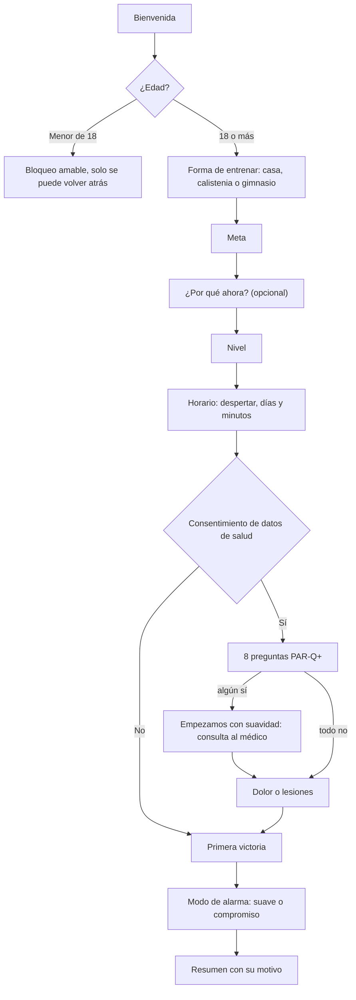
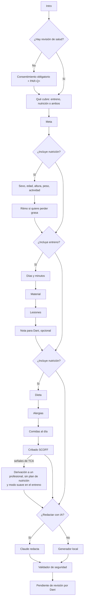

# Fase 2: onboarding, cuestionario de salud y plan con IA

Estado: **implementada en el prototipo** (`index.html`). Al pasar a la app nativa, la lógica de seguridad se reutiliza tal cual (son funciones puras) y la llamada a la IA pasa a una función del servidor (ver la sección 6).

## 1. Qué hay en el prototipo

| Pieza | Dónde | Notas |
|---|---|---|
| Onboarding (sustituye a la encuesta de prueba) | Pantalla completa al abrir por primera vez | Aprovecha las respuestas de la encuesta antigua (`homereps.survey`) si existen |
| Revisión de salud (PAR-Q+) | Onboarding y cuestionario del plan | Siempre con consentimiento explícito **antes** de preguntar |
| Primera victoria (menos de 2 min) | Onboarding | 5 flexiones contando con toques, o 1 minuto suave si hay riesgo. +10 puntos |
| Cuestionario detallado del plan | Today → "Get your personal plan", y Food → "Build my plan" | Distinto del inicial: cuerpo, ritmo, material, lesiones, dieta, alergias, relación con la comida |
| Motor de seguridad | Bloque `safety-core` en `index.html` | Funciones puras con 14 tests en `tests/safety.test.mjs` |
| Generación con IA | Claude, desde la página publicada en claude.ai | Pide permiso al usuario la primera vez. Si no hay IA disponible, se genera en el dispositivo con las mismas reglas |
| Revisión de Dani | Estado "Waiting for Coach Dani’s review" | En el prototipo hay un botón "Prototype: approve as Coach Dani" para simular la aprobación |
| Datos | Food → "Your setup and data" | Repetir el onboarding, crear el plan, borrar las respuestas de salud o borrar todo |

Datos guardados en el navegador (prefijo `homereps.`): `onboarding`, `health`, `plan`, `points`; y siguen `profile`, `schedule`, `done`, `tab` y `survey` (solo se lee).

## 2. Flujos

### Onboarding



### Plan personal



## 3. Reglas de seguridad (motor `safety-core`)

| Regla | Valor | Por qué |
|---|---|---|
| Sin revisión de salud | Modo suave | Línea roja: nada de planes sin cuestionario de salud |
| Algún "sí" en PAR-Q+ (incluye embarazo o parto reciente) | Modo suave + recomendar consulta médica | El PAR-Q+ es el estándar para decidir si hace falta autorización médica |
| Modo suave | Máx. 3 días, 30 min, nivel 1, 2 series, sin ejercicios de impacto | Riesgo bajo mientras no haya autorización |
| Lesiones | Se quitan los ejercicios que cargan esa zona (rodilla, lumbar, hombro, muñeca, cuello) | |
| Días por semana según nivel | 4 / 5 / 6, siempre un día de descanso | Evitar el sobreentrenamiento |
| Solo días que el usuario puede entrenar | Se descartan los demás | |
| Series y repeticiones | Series ≤ nivel + 1; repeticiones ≤ 2 × la dosis por defecto | |
| Cribado SCOFF ≥ 2, IMC < 17,5, o IMC < 18,5 queriendo perder peso | Sin plan de nutrición, derivación y se ocultan las calorías en Food | Línea roja: detectar señales de TCA y derivar |
| Calorías mínimas | La más alta de: 1200 (mujer) / 1500 (hombre), metabolismo basal, déficit máx. del 20 %, pérdida máx. del 0,75 % del peso por semana | Evitar restricción extrema |
| Calorías máximas | +12 % sobre el mantenimiento | Superávit razonable |
| Macros | Proteína entre 1,2 y 2,2 g/kg; grasa entre el 20 y el 40 % de las calorías | |
| Textos prohibidos | Detox, limpiezas, ayunos de agua o de zumo, saltarse comidas, sin carbohidratos, dietas relámpago, pastillas, laxantes | Se eliminan aunque los escriba la IA |

**Ningún borrador se acepta sin pasar por el validador**, ni el de la IA ni el local. El usuario ve qué ajustó ("Our safety check adjusted the draft: …").

**Pendiente antes del lanzamiento:** que un profesional sanitario valide los umbrales y la redacción de PAR-Q+ y SCOFF, y comprobar la licencia de uso del PAR-Q+.

## 4. Prompt de sistema del generador

Fuente de verdad: la constante `PLAN_SYSTEM_PROMPT` en `index.html`. Se envía siempre primero, seguida de los límites de seguridad, los datos anónimos, el catálogo permitido y el formato de salida.

```
You draft personal weekly plans for Home Reps, a home fitness and nutrition app. A coach, Coach Dani, reviews every draft before the user treats it as final.

Hard rules:
1. Safety first. Follow every value in SAFETY LIMITS exactly: never exceed the training days, sets per exercise or exercise level, never use an exercise listed in avoidExerciseIds, and keep every workout within maxMinutesPerWorkout.
2. Use only exercises from EXERCISE CATALOG, referenced by their id. Never invent exercises.
3. Nutrition: stay between calorieFloor and calorieCeiling. Never suggest fasting protocols, detoxes, cleanses, skipping meals, very-low-carb or crash diets, diet pills or supplements. Respect the diet and allergies strictly; if you are not sure an idea is safe for an allergy, leave it out.
4. You are not a doctor. Do not diagnose or talk about treating any condition. If mode is "gentle", keep everything low intensity and say kindly that a doctor should clear harder training.
5. Keep at least one full rest day and progress gradually.
6. Tone: warm, direct and encouraging, in plain English. No guilt, no shame, no comparing bodies, no promises of specific results.
7. If anything in the answers is unclear or might be risky, add a short question to questionsForCoach instead of guessing.
Reply with only one JSON object in the OUTPUT FORMAT.
```

### Qué se envía a la IA (minimización de datos)

- **Se envía:** meta, nivel, forma de entrenar, días y minutos, material, zonas con lesión, la nota opcional para Dani (máx. 200 caracteres). Si incluye nutrición: sexo, edad, altura, peso, calorías de mantenimiento, ritmo, dieta, alergias y comidas al día.
- **No se envía:** nombre, email, el "¿por qué ahora?", las respuestas del PAR-Q+ ni del SCOFF (solo el resultado convertido en límites).
- **El catálogo ya va filtrado:** la IA solo ve los ejercicios permitidos para esa persona y las comidas compatibles con su dieta y alergias.

### Formato de salida

```json
{
  "summary": "2 or 3 warm sentences",
  "days": [{"day": "mon", "title": "Push", "exercises": [{"id": "incline-pushup", "sets": 2, "dose": 10, "restSec": 60, "note": "optional"}]}],
  "nutrition": {"kcal": 2000, "protein": 120, "carbs": 220, "fat": 65, "meals": [{"slot": "breakfast", "idea": "…", "note": "…"}], "tips": ["…"]},
  "safetyNotes": ["…"],
  "questionsForCoach": ["…"]
}
```

## 5. Mecánicas de persuasión aplicadas

| Mecánica | Principio | Por qué es ética |
|---|---|---|
| "¿Por qué ahora?" y mostrarlo en Today ("Your why") | Motivación autónoma (Teoría de la Autodeterminación); coherencia (Cialdini) | Son sus palabras; es opcional y no se envía a la IA |
| Primera victoria de 5 flexiones o 1 minuto, con confeti y +10 puntos | Fogg: facilidad + celebración inmediata | Se puede saltar sin penalización ("I’ll do it later") |
| Barra de progreso y "3 de 15" en los cuestionarios | Efecto de gradiente de meta | Refleja el avance real |
| Plan revisado por Dani | Autoridad real y confianza | Es verdad: el plan queda pendiente hasta que Dani lo revisa |
| +50 puntos al completar el cuestionario | Refuerzo de la acción deseada | Una sola vez; no se puede repetir para acumular |

## 6. Al pasar a la app nativa

- El bloque `safety-core` se mueve a `packages/core` (TypeScript) y se reutilizan los mismos tests.
- La llamada a la IA pasa a la función del servidor `generate-plan`. Lleva el mismo prompt, datos mínimos, proveedor con acuerdo de encargado del tratamiento y región UE. El validador se ejecuta **en el servidor**, nunca solo en el móvil.
- El estado "pending_review" lo cambia Dani desde su panel (fase 4), no un botón del usuario.
- Los datos de salud van a tablas cifradas separadas, con el consentimiento registrado (ya se guarda la versión: `proto-2026-11`).

## 7. Pendiente tras la fase 2

- Validación profesional de umbrales y textos de salud y de TCA. Licencia del PAR-Q+.
- Decidir con Dani el plazo de revisión que se promete ("usually within 48 hours" es provisional).
- La alarma real y la cámara son de la fase 3 (solo se guarda la preferencia de modo de alarma).
- La economía de puntos completa (rachas, niveles, canjes) es de la fase 4. Ahora solo se registran los puntos de la primera victoria y del cuestionario.
